# 客户视角流程审查

审查日期：2026-11-07，Asia/Shanghai。本次实际访问Windows本机网站，使用本机真实开发账户；覆盖桌面及390×844手机视口。所有证据均来自本次审查。未转账、未伪造到账；付款后交付流程不能据此前半段检查视为通过。

## 逐步结果

| 步骤 | 客户动作 | 结果与边界 | 证据 |
| --- | --- | --- | --- |
| 1 | 访客进入首页 | 已补上直接登录；空账户不展示其他账户数据 | 16-guest-home-after.png |
| 2 | 错误访问码、正确登录、退出 | 错误可恢复；有效访问码可登录；跨标签退出立即清空订单 | 03-login-error.png、15-cross-tab-logout.png |
| 3 | 套餐月/年、标价/USDT切换 | 正常；美元临时价不再误标CNY；年付明确排除月付临时测试优惠 | 04-plans-before.png、17-mobile-plans-after.png |
| 4 | 进入付款确认 | 显示真实服务端5美元报价、BSC、禁用未接入渠道；未执行转账。以前生成的5USDT订单已过期，需重新创建 | 18-checkout-after.png |
| 5 | 查看、检索与恢复订单 | 金额保留原币种；搜索空结果正常；继续处理返回原订单。敏感订单截图仅保留本机 | 本机06-orders.png |
| 6 | 我的套餐与订阅 | 正确显示未开通；实际节点、订阅和计量尚未接入 | 05-subscription.png |
| 7 | 积分中心 | 明确未开放；无虚假签到、返现、抵扣 | 07-points.png |
| 8 | 礼品卡选购与兑换 | 套餐报价币种正确；空输入禁用、非法兑换码有错误、请求中防重复；真实签发/兑换后交付未实付验收 | 08-gifts.png、18-checkout-after.png |
| 9 | 我的邀请 | 明确由管理员发放；自助邀请/奖励尚未实现 | 09-invite.png |
| 10 | 工单提交、追加、回复、关闭 | 已实际完成一张明确标识为本机验收的工单，保留真实记录；管理员使用CLI回复 | 本机10-ticket-replied.png |
| 11 | 知识库搜索和阅读 | 混合大小写及首尾空格正常，文章可返回；未验证尚不存在的真实订阅导入 | 11-knowledge-search.png、12-article.png |
| 12 | 用户设置与账户隔离 | 登录/退出可用；说明人民币渠道未开通；刷新失败显示重试提示 | 03-login-error.png、15-cross-tab-logout.png |
| 13 | 手机导航、套餐操作 | 已修复周期切换按钮内部横向滚动；390px视口两组切换器均clientWidth=scrollWidth=165 | 13-mobile-nav.png、14-mobile-plans-before.png、17-mobile-plans-after.png |

## 已修复

- 访客首页登录入口不明显；现直接提供登录表单。
- 混合美元临时测试报价下CNY标签误导；现显示“标价”，基础版年付单独说明常规年价。
- 手机周期按钮裁切和内部滚动；修复窄屏字号和宽度。
- 账户信息更新失败原先静默保留旧结果；现显示错误与重试。
- 跨标签页退出延迟；现同步清空状态，账户变化关闭旧付款弹窗，过期请求不能覆盖新会话。
- 礼品卡兑换缺少忙碌状态；现禁用重复提交、限制输入、标记错误字段。
- 知识库原本已经支持大小写混合，新增忽略首尾空格。
- 付款详情增加收款地址和金额复制按钮、改善地址可读性；键盘焦点可见，错误输入与说明关联。
- 依赖审计从6项修复至0项；Vite升级至6.4.5，保留兼容主版本。

## 未通过实付或尚未实现的部分

- 主网付款到账通知仍需本人真实转账验收。不得将测试用例中的隔离签名通知当成真实到账。
- 节点资源、订阅签发、流量计量未接入；付款仅进入待开通队列。
- 积分、自助邀请和奖励、人民币商户收款及自动退款未开放。
- 礼品卡真实签发依赖真实付款；兑换成功仍需实际套餐交付。
- 本机临时通知入口不等于正式运营基础设施。没有部署VPS、修改DNS或开放网站/后台公网。

## 可访问性与验证限制

已查看文本标签、语义标题、错误提示、键盘焦点和手机布局；修复错误字段关联与导航展开状态。未做完整屏幕阅读器、全站对比度、200%缩放或WCAG认证，不能宣称全面符合无障碍标准。

## 自动验证

72项隔离测试通过；生产构建通过；npm audit报告0项已知漏洞。GitHub Actions将在干净的Windows/Linux环境执行相同构建与测试，不调用真实付款配置。

## 截图证据

订单详情和实际工单对话仅保留本机 `web/qa/customer-audit/`，未随源码上传；本报告只附不含访问码、商户密钥、RPC密钥及实际财务记录的页面证据。

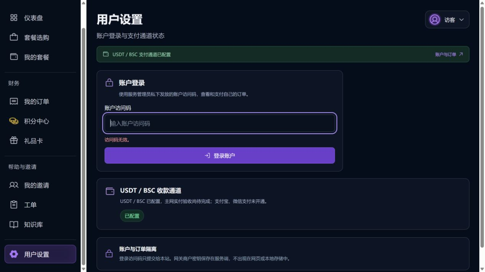

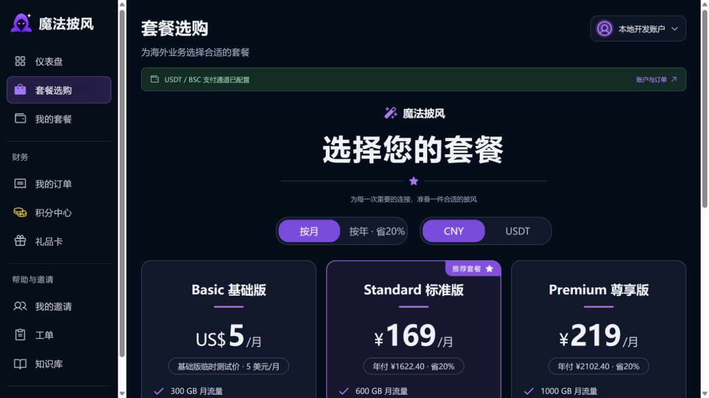

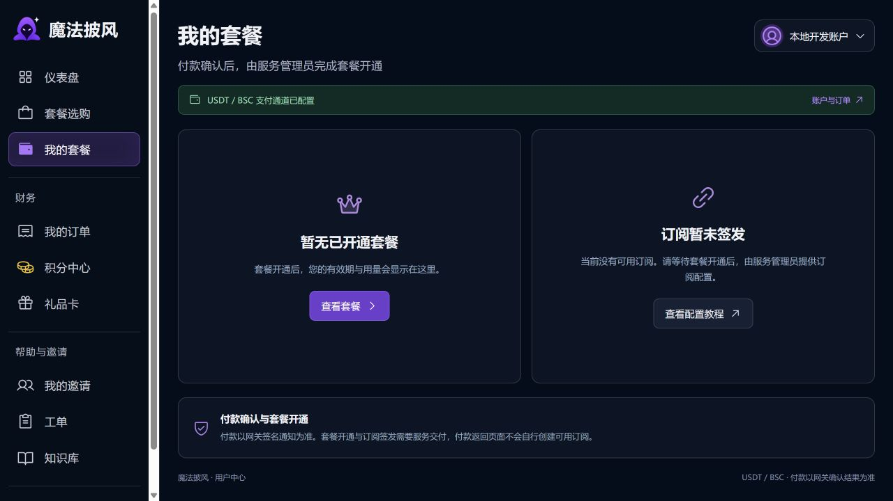

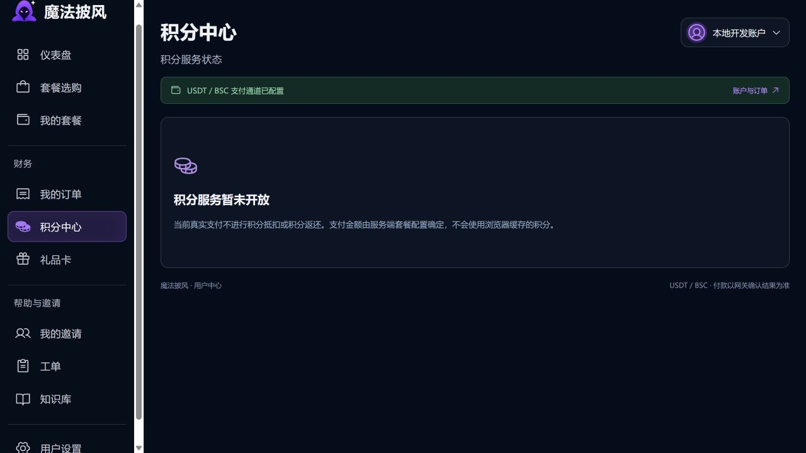

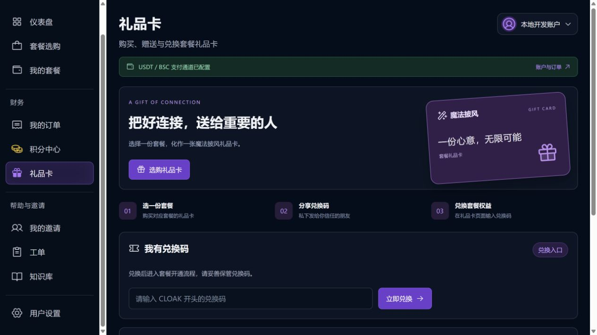

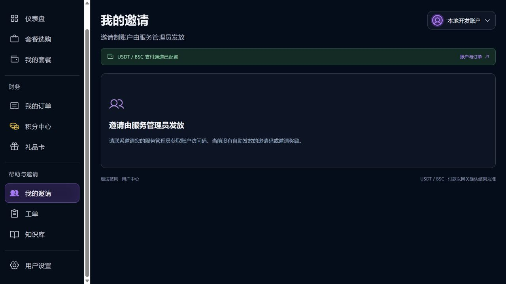

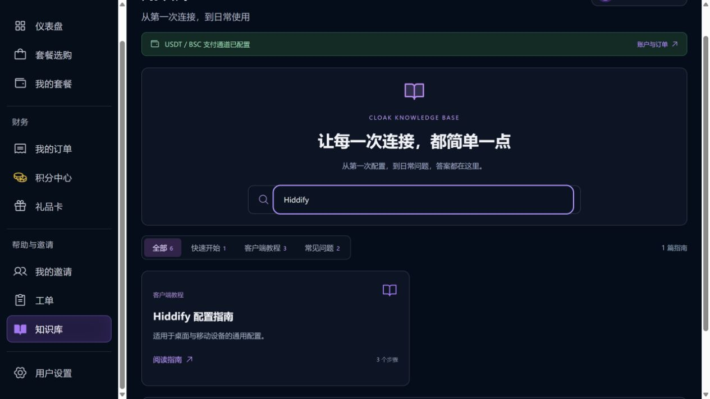

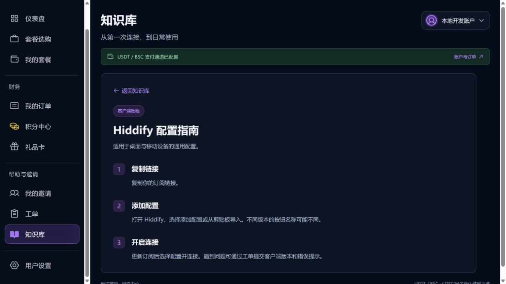

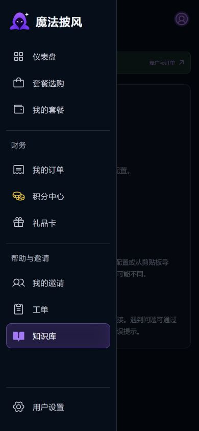

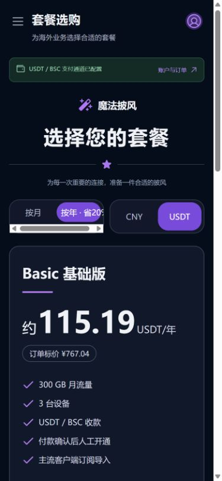

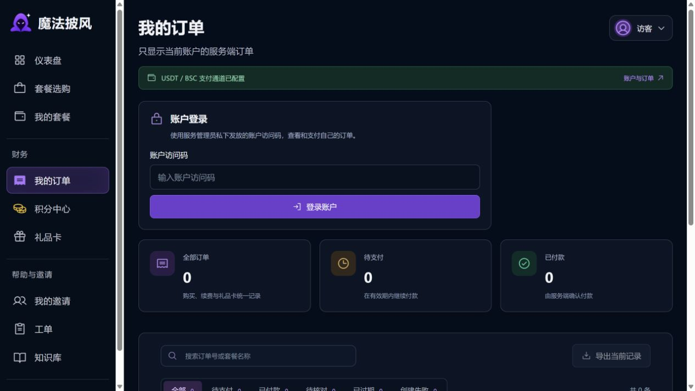

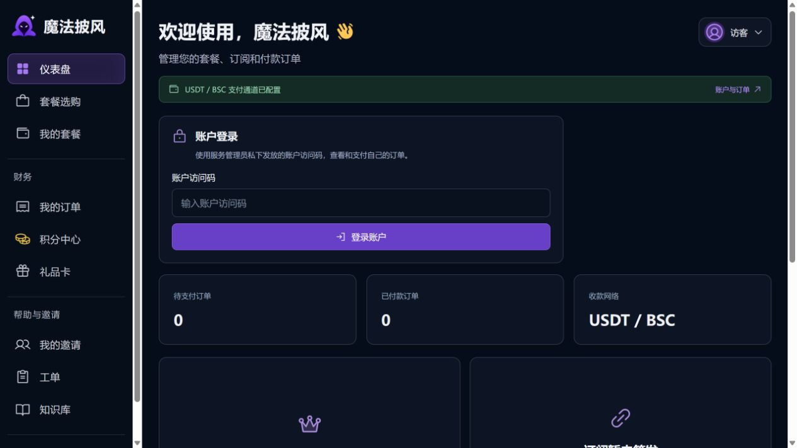

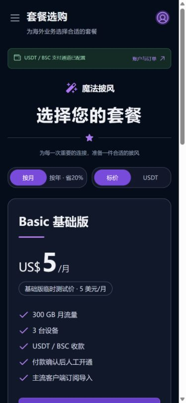

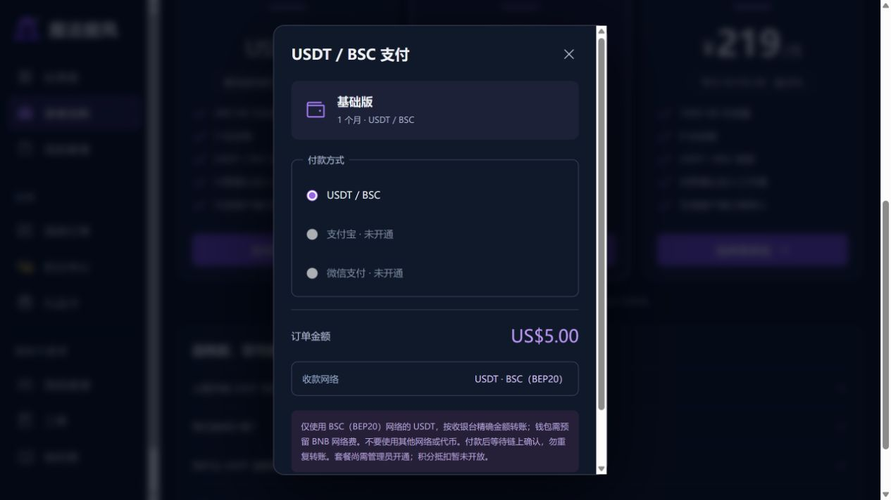
